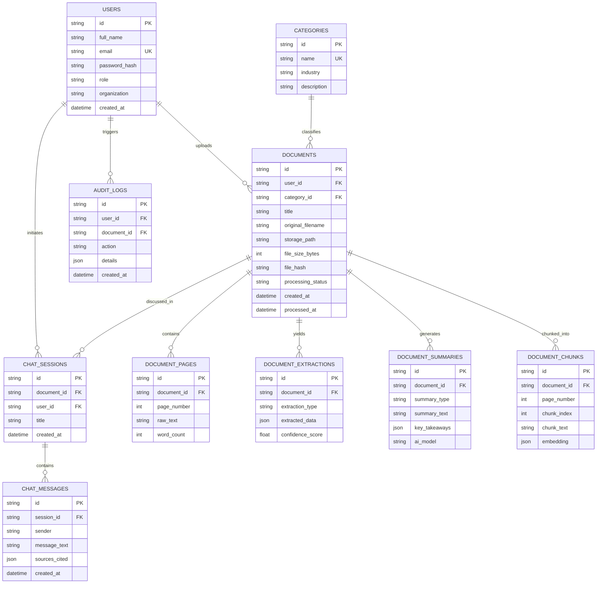

# DocIntel Database Architecture & Design
**Cortex Intelligence and Technologies**  
*Product: DocIntel – Intelligent Document Processing & Analysis*

---

## 1. Architectural Overview

DocIntel is designed around an end-to-end document intelligence pipeline:
1. **Document Ingestion**: Multi-user and multi-tenant PDF document uploads with cryptographic deduplication (`file_hash`).
2. **Document Processing & OCR/Text Extraction**: Storing page-level texts with word counts.
3. **Structured Data Extraction**: Flexible JSON-based key-value pairs, entities, and table schema extractions with confidence ratings.
4. **AI-Powered Summarization**: Multi-format summaries (Executive, Concise, Bullet Points, Section-by-Section) with token accounting.
5. **RAG & Chat Readiness**: Page chunking with vector embedding fields, conversational chat sessions with citations.
6. **Enterprise Governance & Audit**: Immutable audit logging for privacy compliance and tracking user actions.

---

## 2. Entity Relationship Diagram (ERD)

---

## 3. Data Dictionary

### 3.1 `users`
| Column | Type | Constraints | Description |
|---|---|---|---|
| `id` | UUID / TEXT | PRIMARY KEY | Unique user identifier |
| `full_name` | VARCHAR(255) | NOT NULL | User's full name (e.g. Heli Patel, Saud Rana) |
| `email` | VARCHAR(255) | UNIQUE, NOT NULL | Account login email |
| `password_hash` | VARCHAR(255) | NOT NULL | Secure salted password hash |
| `role` | VARCHAR(50) | CHECK enum | 'Admin', 'Project Operator', 'Analyst', 'Viewer' |
| `organization` | VARCHAR(255) | DEFAULT | Cortex Intelligence and Technologies |
| `is_active` | BOOLEAN | DEFAULT TRUE | Account state |
| `created_at` | TIMESTAMP | DEFAULT NOW | Creation timestamp |

### 3.2 `categories` (Use Cases)
Pre-populated with targeted industries:
- **Education**: Academic & Research Papers
- **Healthcare**: Medical Documentation
- **Legal**: Contracts & Agreements
- **Corporate**: Corporate Reports & SOPs
- **Finance**: Financial Statements & Audits
- **Research**: Scientific & Technical Specs

### 3.3 `documents`
Tracks all uploaded PDF documents, file hashes for deduplication, storage locations, and live pipeline status (`PENDING`, `PROCESSING`, `COMPLETED`, `FAILED`).

### 3.4 `document_pages`
Stores the raw extracted text per page with word counts, enabling page-by-page viewing and citation mapping.

### 3.5 `document_extractions`
Stores structured data extracted from the document in JSON format. Types include:
- `KEY_VALUE`: Key form fields and attributes
- `ENTITIES`: People, organizations, dates, locations, legal clauses
- `TABLES`: Structured financial/tabular data
- `METADATA`: Document title, author, version, etc.

### 3.6 `document_summaries`
Stores multi-tier AI summaries generated by models like Gemini:
- `EXECUTIVE`: High-level executive briefing
- `CONCISE`: Brief 2-3 sentence overview
- `DETAILED`: Comprehensive multi-paragraph analysis
- `BULLET_POINTS`: Key takeaways array in JSON

### 3.7 `document_chunks`
Supports **Future Enhancements** (RAG, Semantic Search). Splits document pages into overlapping text chunks with vector embeddings ready for cosine similarity lookup.

### 3.8 `chat_sessions` & `chat_messages`
Powers the **Chat with PDF** capability. Stores multi-turn dialogues with linked citation page numbers.

### 3.9 `audit_logs`
Ensures compliance with enterprise privacy guidelines by recording every upload, view, extraction, and deletion event.

